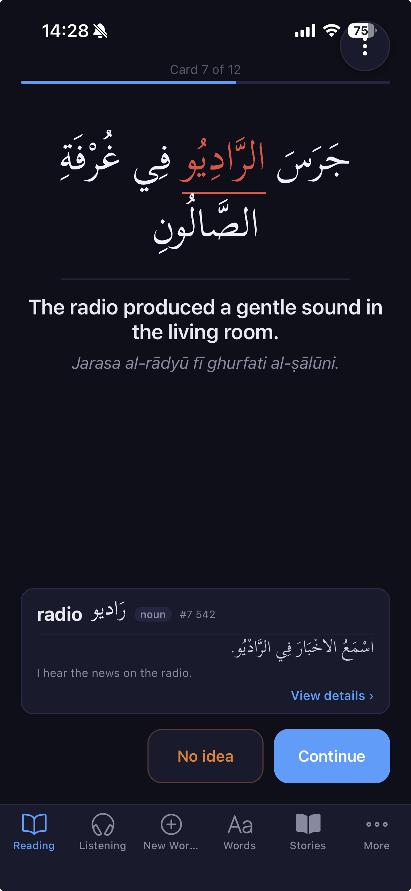
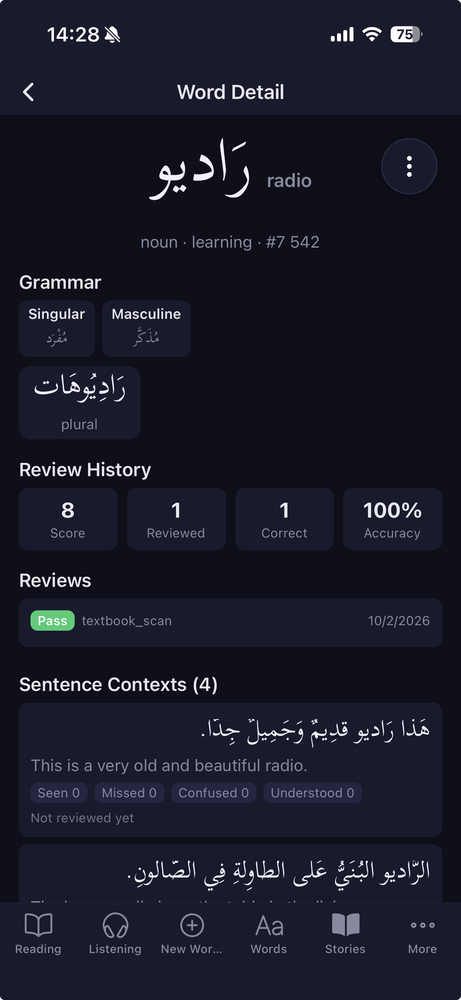

# Alif — Arabic Reading & Listening Trainer

A personal Arabic (MSA/fusha) reading and listening trainer. You review whole sentences rather than flashcards; every word contributes learning evidence, while eligible words receive acquisition or FSRS scheduling. An LLM pipeline generates sentences and stories from the words you already know. Its author has been learning with it since February 2026.

Blog posts: [why it exists](https://networkedthought.substack.com/p/how-an-iraqi-play-about-cain-and) · [technical deep dive](https://networkedthought.substack.com/p/alif-technical-deep-dive)

<p align="center">
  
  
</p>

## Start here if you are a coding agent

Read [`CLAUDE.md`](CLAUDE.md) before editing, regardless of which agent you use. It contains the architecture, hard invariants, required checks, and operational guidance. Follow the applicable user and agent instructions; merging a PR requires Stian's specific authorization.

Then read the reference for the area you are changing:

- **Learning state, review credit, or intake:** [`docs/scheduling-system.md`](docs/scheduling-system.md) and [`docs/design-principles.md`](docs/design-principles.md). Distinguish encounter evidence from scheduled review credit and check the active policy rather than assuming every lookup enrolls a word.
- **Backend, schema, or API:** [`docs/backend-services.md`](docs/backend-services.md), [`docs/data-model.md`](docs/data-model.md), and [`docs/api-reference.md`](docs/api-reference.md).
- **Frontend and readers:** [`docs/frontend-files.md`](docs/frontend-files.md), [`docs/review-modes.md`](docs/review-modes.md), and [`docs/supported-reading-chapters.md`](docs/supported-reading-chapters.md).
- **Generation or Arabic analysis:** [`docs/nlp-pipeline.md`](docs/nlp-pipeline.md), the relevant service history, and [`research/experiment-log.md`](research/experiment-log.md).
- **Greek/Latin or the Spanish prototype:** their own guides, starting with [`polyglot/CLAUDE.md`](polyglot/CLAUDE.md) or [`spanish-pilot/README.md`](spanish-pilot/README.md). They use separate backends and databases.

The recorded near-term goal is to finish Kanafani's *Men in the Sun* by 31 December 2026, with book-driven vocabulary intake and weekly timed reading/recall tests. See the [novel sprint protocol and handoff](research/novel-sprint-2026-10/README.md) and [`IDEAS.md`](IDEAS.md). These describe the plan and recorded progress; verify live deployment and policy separately.

## How it was built

Alif was written almost entirely by coding agents (Claude Code, later also Codex), steered by one person over many iterations. The files that keep the agents on track are the most reusable part of the repo:

- [`CLAUDE.md`](CLAUDE.md): architecture, LLM routing, and a list of "hard invariants", each one added after it caused a production bug or data corruption.
- [`docs/`](docs/): reference docs the agents read before changing an area (scheduling, NLP pipeline, data model, API, design principles).
- [`.claude/skills/`](.claude/skills/): project skills for deploy, smoke tests, log checks, backups and data-quality audits.
- [`research/`](research/): dated analyses and model A/B comparisons that justify design and model-routing decisions.
- [`CHANGELOG.md`](CHANGELOG.md) and [`IDEAS.md`](IDEAS.md): what changed and why, and the backlog.

> **Shared as-is.** Built for one person's learning, not packaged as an open-source product. It contains the author's server references and deployment scripts (see [Files You Need to Personalize](#files-you-need-to-personalize)). Setting up your own instance means reading the code; a coding agent can do most of that for you.

## Architecture

- **Backend**: Python / FastAPI / SQLite (single user, no auth, WAL mode), Alembic migrations — `backend/`
- **Frontend**: Expo SDK 54 (React Native), iOS and web — `frontend/`
- **SRS**: py-fsrs v6, plus an acquisition (Leitner-style) phase for new words
- **LLM**: Batch and background work runs through the Claude CLI (`claude -p`): Sonnet for sentence generation, Opus for stories. Quality gates, enrichment and verification route through the Codex CLI first, falling back to Claude CLI and then the OpenAI/Anthropic APIs. Interactive chat calls the Anthropic API directly for latency. Gemini is used only for OCR. See `backend/app/services/llm.py`.
- **NLP**: Rule-based clitic stripping + CAMeL Tools morphological analysis + LLM disambiguation — [`docs/nlp-pipeline.md`](docs/nlp-pipeline.md)
- **TTS / audio**: ElevenLabs, pydub + ffmpeg for podcast stitching
- **Deployment**: venv + systemd on a single small VPS (no Docker)
- **Sister apps in this repo**: [`polyglot/`](polyglot/) (Modern/Ancient Greek and Latin, ported from Alif) and [`spanish-pilot/`](spanish-pilot/) (standalone classroom prototype)

## What It Does

- **Sentence-first review**: Spaced repetition at the sentence level. A greedy set-cover algorithm picks sentences that maximize coverage of your due words. You tap words you missed or found confusing. All content words retain encounter/token evidence; acquisition and FSRS transitions depend on eligibility and the active review policy. Intro cards teach each new word before its first sentence appearance.
- **Reading mode**: See diacritized Arabic, tap words to look them up (with root-family predictions), then self-rate comprehension. Well-known words fade their diacritics (tashkeel fading), and cards alternate between two Arabic fonts (Scheherazade New + Amiri) to build familiarity with both learner-friendly and print-style typography.
- **Listening mode**: Hear TTS audio first, then reveal text. Story audio with voice rotation (3 ElevenLabs voices). Supports Professional Voice Clones.
- **Podcast generation**: Personalized audio episodes built from your FSRS vocabulary state. Six formats: sentence drill, story breakdown, comprehensible input, root explorer, word spotlight, story retelling. Segments stitched via pydub/ffmpeg with per-segment caching.
- **Learn mode**: Introduces new words with info-dense cards: forms tables, root/pattern chips, etymology, memory hooks, example sentences. Rescue cards re-teach stuck words (≥4 reviews, <50% accuracy).
- **Story mode**: Generate micro-fiction in 4 formats (standard, long, breakdown, arabic_explanation) with your known vocabulary, or import any Arabic text. Tap-to-lookup reader with completion evidence and policy-dependent scheduling credit. Story audio with voice rotation, archive system, passive `times_heard` tracking. Auto-generate cron keeps ≥3 active stories.
- **Slow book reader**: Keep novels and processed bilingual texts in a separate page-first library. Importing/opening is learning-state neutral; completing an exact passage commits its evidence. Clean and guided policies distinguish recognition from gloss-supported reading; automatic attention selects maintenance eligibility, so a lookup alone does not enroll a word. Misses on already introduced, maintained words use the normal rating-1 transition. Full English translation stays one tap away while reading.
- **Supported chapter reading**: A separate reader offers vocabulary previews and optional voice/text feedback without scheduled review credit or direct enrollment. Repeated uniquely resolved help in distinct paragraphs can inform later attention priority.
- **Textbook scanner**: OCR Arabic pages via Gemini Vision, extract words, add them to your vocabulary. Batch processing with crash recovery.
- **Grammar tracking**: 49 grammar features across 8 tiers, with LLM-generated lessons.
- **Arabic NLP pipeline**: 7-stage sentence generation pipeline with 3-pass lemma lookup, clitic stripping, CAMeL Tools morphological analysis, root extraction, LLM mapping verification/correction, and LLM-confirmed variant detection with multi-hop chain resolution.

## Setting Up Your Own Instance

### Prerequisites

| Key | Service | Required? | Used for |
|-----|---------|-----------|----------|
| — | Claude Code CLI (`claude`) | Recommended | Sentence/story generation; fallback for quality gates |
| — | Codex CLI (`codex`) | Optional | Default for quality gates and enrichment; set `ALIF_AUDIT_PROVIDER=claude` to skip |
| `OPENAI_KEY` | OpenAI | Optional | API fallback when the CLIs are unavailable |
| `ANTHROPIC_API_KEY` | Anthropic | Recommended | Interactive chat; API fallback |
| `GEMINI_KEY` | Google AI Studio | Optional | Textbook OCR only |
| `ELEVENLABS_API_KEY` | ElevenLabs | Optional | TTS for listening mode, story audio, and podcasts |

You need the Claude CLI or at least one LLM API key. Without `ELEVENLABS_API_KEY`, listening mode, story audio, and podcast generation won't work but everything else will.

### Quick Start (local)

```bash
# Backend
cd backend
python3 -m venv .venv
cp .env.example .env    # fill in your API keys
.venv/bin/pip install -e ".[dev]"
.venv/bin/python scripts/import_duolingo.py   # seed starter words
.venv/bin/uvicorn app.main:app --port 8000

# Frontend (separate terminal)
cd frontend
npm install
ALIF_API_URL=http://localhost:8000 npx expo start --web
```

### Importing processed bilingual books

Bookifier caches and Alif `bookify_arabic.py` JSON can be imported without
re-running OCR or translation:

```bash
cd backend
.venv/bin/python scripts/import_reader_book.py \
  data/kalila_dove.json

# A title-less Bookifier translation cache needs explicit metadata:
.venv/bin/python scripts/import_reader_book.py \
  ../../bookifier/bilingual/cache/rijal_abu_qays.v3.json \
  --title-ar "رجال في الشمس — أبو قيس" \
  --title-en "Men in the Sun — Abu Qays"
```

The importer may extend the lexical catalog, but it creates no
`UserLemmaKnowledge` rows and imported books do not enter the automatic curriculum. Reader lookup
drafts survive navigation/restarts; learner state changes only when a page is
explicitly completed.

### Connecting Frontend to Backend

[`frontend/app.config.js`](frontend/app.config.js) reads `ALIF_API_URL` at bundle time and exposes it as `extra.apiUrl`. For local web development, use the command above. For a physical device, use a backend address reachable from that device and bind Uvicorn to the appropriate interface; `localhost` on a phone refers to the phone itself.

The committed `app.json` contains a deliberately nonfunctional API placeholder. An unconfigured frontend therefore cannot reach the backend. Supply the URL through the environment rather than committing a private production capability URL. Restart Expo after changing it.

## Deploying to a VPS (Hetzner, etc.)

The app is designed to run on a single cheap VPS. Here's how to set it up from scratch.

### 1. Provision a server

The following example uses an Ubuntu 24.04 VPS. Choose capacity for the services and language-analysis data you intend to run.

Set up SSH key access:
```bash
# On your local machine
ssh-keygen -t ed25519 -f ~/.ssh/myserver
ssh-copy-id -i ~/.ssh/myserver root@YOUR_SERVER_IP

# Add an alias to ~/.ssh/config
Host alif
    HostName YOUR_SERVER_IP
    User root
    IdentityFile ~/.ssh/myserver
```

### 2. Install dependencies on the server

```bash
ssh alif

# Python + Node.js (for the Expo dev server)
apt-get update
apt-get install -y python3 python3-venv git
curl -fsSL https://deb.nodesource.com/setup_22.x | bash -
apt-get install -y nodejs
```

### 3. Clone and configure

```bash
cd /opt
git clone https://github.com/YOUR_USER/alif.git
cd alif

# Create backend/.env with your API keys
cat > backend/.env << 'EOF'
GEMINI_KEY=your-gemini-key
OPENAI_KEY=your-openai-key
ANTHROPIC_API_KEY=your-anthropic-key
ELEVENLABS_API_KEY=your-elevenlabs-key
EOF
```

### 4. Start the backend

```bash
cd /opt/alif/backend
python3 -m venv .venv
.venv/bin/pip install -e .

# Create systemd service
cat > /etc/systemd/system/alif-backend.service << 'EOF'
[Unit]
Description=Alif Backend API
After=network.target

[Service]
Type=simple
WorkingDirectory=/opt/alif/backend
ExecStart=/opt/alif/backend/.venv/bin/uvicorn app.main:app --host 0.0.0.0 --port 3000
Restart=always
RestartSec=5
EnvironmentFile=/opt/alif/backend/.env

[Install]
WantedBy=multi-user.target
EOF

systemctl daemon-reload
systemctl enable --now alif-backend
# Verify: curl http://localhost:3000/api/stats
```

The backend runs as a plain systemd service reading from `/opt/alif/backend/.venv`. The SQLite database lives at `/opt/alif/backend/data/alif.db`.

### 5. Seed starter vocabulary

```bash
cd /opt/alif/backend && .venv/bin/python scripts/import_duolingo.py
```

### 6. Start the frontend (Expo dev server)

The frontend runs as a systemd service outside Docker:

```bash
# Install frontend dependencies
cd /opt/alif/frontend
npm install

# Create systemd service
cat > /etc/systemd/system/alif-expo.service << EOF
[Unit]
Description=Alif Expo Dev Server
After=network.target

[Service]
Type=simple
WorkingDirectory=/opt/alif/frontend
Environment=REACT_NATIVE_PACKAGER_HOSTNAME=YOUR_DOMAIN_OR_IP
Environment=ALIF_API_URL=https://YOUR_API_HOST/YOUR_PRIVATE_API_PATH
ExecStart=/usr/bin/npx expo start --web --port 8081
Restart=always
RestartSec=5

[Install]
WantedBy=multi-user.target
EOF

systemctl daemon-reload
systemctl enable --now alif-expo
```

Replace `YOUR_DOMAIN_OR_IP` with your server's IP or domain name and configure the API URL in the next step. This runs the web development server; the author's installed iOS app uses a standalone EAS build.

### 7. Point the frontend at your backend

Set `ALIF_API_URL` in the frontend service environment to your reachable backend URL. For a public deployment, use an HTTPS reverse proxy with private access; the single-user FastAPI backend has no application authentication and should not be exposed directly to the internet. The author's deployment uses a private HTTPS capability path, supplied outside Git.

After editing a systemd unit, run `systemctl daemon-reload` and restart `alif-expo`. The same environment variable must be present when exporting a static web bundle.

### 8. (Optional) Set up a domain with DuckDNS

[DuckDNS](https://www.duckdns.org/) gives you a free subdomain that points at your server IP:

```bash
# One-time setup
curl "https://www.duckdns.org/update?domains=YOURNAME&token=YOUR_TOKEN&ip=YOUR_SERVER_IP"
```

Then use `YOURNAME.duckdns.org` for `REACT_NATIVE_PACKAGER_HOSTNAME` and configure your HTTPS API URL through `ALIF_API_URL`.

### 9. (Optional) Set up backups

`scripts/backup.sh` pulls a verified SQLite online backup from the server to a local machine with daily/weekly/monthly retention. Its defaults match the author's host; override the `ALIF_BACKUP_*` environment variables documented in the script. It also pulls snapshots of a separate project (Koigen) and fails if they are missing, so remove that part for your own setup.

### 10. Deploy updates

Deploy only after the change has been merged to `main` with Stian's specific authorization and pushed to GitHub. Deployment itself also needs to be requested. Never deploy a feature branch. See [`CLAUDE.md` → Deployment](CLAUDE.md#deployment) for the operational checklist and service-specific commands.

For the author's backend, begin by selecting `main` explicitly, pulling without a merge, and checking that the printed commit is the intended release:

```bash
ssh alif "cd /opt/alif && git checkout main && git pull --ff-only && git log --oneline -1"
```

Before data-changing migrations or backfills, back up the database. Install dependencies and restart the affected service using the project guide, then verify the actual endpoint/schema behavior. A running systemd service alone does not prove the update landed. Alif and Polyglot have separate services and virtual environments.

The frontend has separate publication paths:

- **Installed iOS app:** a standalone EAS `preview` build with OTA JavaScript/assets. From clean, up-to-date `main`, run `scripts/publish-ios-update.sh "description of the update"`. The wrapper reads the private API capability from `~/.config/alif/api-capability` and verifies the resolved config and published manifest. Use the wrapper for OTA publication. Native changes require a version/runtime bump and a new build; see the project guide.
- **Web:** a web bundle needs `ALIF_API_URL` at build time. For the legacy Metro service, follow the project guide's cache-clearing restart procedure; a plain restart can serve stale transforms. Check the deployed page after publication.

`scripts/deploy.sh` is a legacy convenience script: it does not itself enforce the full `main` selection or publish an iOS OTA. Read it alongside the current project guide before using it.

### Connecting from your phone

The author's iOS app is installed from an EAS preview build and does not depend on Metro. OTA updates download in the background and normally apply on a subsequent cold launch. Expo Go is a development option, not the installed app's production update path.

### Using Claude Code for deployment

If you're using Claude Code, update the references in `CLAUDE.md` and `.claude/skills/` to point at your server, and Claude will handle deploys for you. Tell it something like "update all deployment references to my server at 1.2.3.4 with domain foo.duckdns.org" and it will find and update everything.

## Files You Need to Personalize

This codebase has hardcoded references to the original author's server, SSH alias, and domain. Here's what to update for your own setup:

| File | What's in it | What to do |
|------|-------------|------------|
| `frontend/app.config.js`, `frontend/app.json` | API environment override, app identity, EAS project/update IDs | Supply `ALIF_API_URL`; use your own app identity and EAS project for native builds |
| `backend/.env` | API keys and backend settings | Copy `backend/.env.example` and fill in your own values |
| `CLAUDE.md` | Server IP, SSH alias, DuckDNS domain, systemd service names | Update the Hosting/Deployment/Expo sections for your setup, or remove them if running locally |
| `.claude/skills/deploy.md` | Hardcoded deploy commands with server references | Rewrite for your server, or delete |
| `.claude/skills/backup.md` | Backup procedure and host references | Update for your host |
| `.claude/skills/smoke-test.md` | Server IP in production section | Update or remove production commands |
| `scripts/deploy.sh` | SSH alias, DuckDNS domain | Update `SERVER` and `EXPO_URL` variables |
| `scripts/backup.sh` | SSH alias and Koigen checkout paths | Defaults match the `alif` host; override the documented `ALIF_BACKUP_*` / `KOIGEN_*` environment variables for another installation |

If you're using Claude Code, you can just tell it "update all the deployment references to point at my server at X" and it will know what to do — `CLAUDE.md` documents the full architecture.

## Seeding Vocabulary

The app starts with an empty database. Import starter vocabulary with any of:

```bash
cd backend
python scripts/import_duolingo.py     # 196 words from Duolingo Arabic
python scripts/import_wiktionary.py   # larger set from Wiktionary
python scripts/import_avp_a1.py       # A1-level Arabic Vocabulary Project
```

You can also add words through the app itself: Learn mode introduces words one at a time, Story import analyzes pasted Arabic text, and the Textbook scanner OCRs photographed pages.

## Disabling CAMeL Tools

CAMeL Tools is an Arabic morphological analyzer that adds ~660MB of data files. The app works without it — all morphology calls fall back to stubs gracefully. To disable:

1. Remove `camel-tools>=1.5.0` from `backend/pyproject.toml`
2. Skip the `camel_data` download during install

You lose: lemmatization, root extraction, MLE disambiguation, variant detection. You keep: clitic stripping (rule-based), function word handling, FSRS scheduling, LLM generation, everything else.

## Tests

```bash
cd backend && .venv/bin/python -m pytest    # fast suite; hermetic, slow provider tests excluded
```

The fast suite blocks real provider calls and external network access. Tests marked `slow` make real LLM calls and must be selected explicitly. For frontend changes, run the relevant tests and typecheck from `frontend/`; see [`CLAUDE.md` → Testing](CLAUDE.md#testing).

## Adapting for Another Language

This is deeply Arabic-specific. The following would need replacement for another language:

- **Clitic stripping** (`sentence_validator.py`) — Arabic proclitics/enclitics
- **CAMeL Tools** (`morphology.py`) — Arabic-only morphological analyzer
- **Root system** (`roots` table) — Semitic tri-consonantal roots
- **Function words** — 60+ hardcoded Arabic function words
- **Diacritics/normalization** — tashkeel, hamza/alef normalization
- **RTL rendering** — throughout the frontend
- **TTS pauses** — inserts Arabic commas for learner-speed audio
- **LLM prompts** — all instruct "generate Arabic sentences"
- **Import scripts** — Arabic vocabulary sources

The FSRS scheduling, greedy set-cover session assembly, grammar tier system, story mode, and general UI architecture are language-agnostic in principle, but extracting them would be a significant project.
