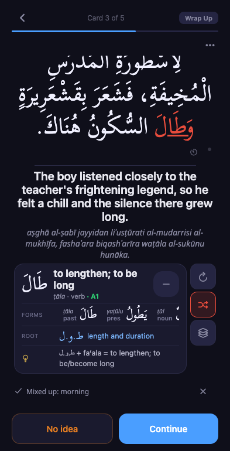

# Arabic automaticity: production audit and implementation

3 November 2026. Source: SQLite online backup of production after the morning's
practice (latest sentence review 07:41:44 UTC / 08:41:44 Oslo), plus September–November
interaction logs. Production code and implementation base: `6f3c02e6` (PR 292).
No production learning state was changed. Snapshot SHA-256 is in `statistics.json`;
the analyzer opens it read-only and verifies its hash before and after.

## What today's data says

| Reading reviews | September | October | Last 14 days | Last 7 days | This morning |
|---|---:|---:|---:|---:|---:|
| Sentence-review rows | 656 | 341 | 116 | 75 | 28 |
| Days with reading reviews | 23 | 26 | 11 | 6 | 1 |
| Reviews per calendar day | 21.9 | 11.0 | 8.3 | 10.7 | — |
| Fully understood | 41.9% | 44.9% | 52.6% | 56.0% | 60.7% |
| Clean/no-help proxy | 265 (40.4%) | 144 (42.2%) | 55 (47.4%) | 37 (49.3%) | 17 (60.7%) |

The proxy requires understood, no recorded red/yellow IDs, protocol-v3 token
evidence all rating 3, no front tashkeel toggles, no logged lookups/audio, and a
non-passage card. Historical clients omit zero lookup/audio counts; the proxy
interprets absence as zero only on matched protocol-v3 events, reflecting the
current historical client serialization. This is **not proof of uninterrupted,
unaided reading**. It also cannot detect assistance outside Alif. Logs join by
session and sentence because older events omit the client review ID; repeated
same-sentence submissions within one session can therefore be ambiguous.

These are sentence-review rows; the card-type restriction applies to the clean
proxy. The sample is the app's selected review material, not a fixed proficiency
test. Reading outside Alif and time spent in other app modes are not counted.

The proxy's median old response time is about 24–26 seconds in every period.
That does not establish a fluency plateau: it includes the answer side and idle
time, excludes times above five minutes, and compares changing sentence lengths,
forms, and difficulty. Do not use it as a word-recognition clock or fit a fast/slow
mixture and call the components automatic/nonautomatic.

## Retention, forgetting intervals, and engagement

Canonical content-word **primary** reading outcomes are almost unchanged:
77.1% clean in September (655), 76.9% in October (338), 84.4% in November so far
(45). Primary means the selected target, rather than every collateral word
in its sentence. A sentence can fail because of another word while its primary
word is correct; this explains why these percentages exceed whole-sentence clean
rates. These observations support retention of substantial vocabulary despite
less activity. They do not establish that the two workloads are equivalent.

Among already-due, non-acquisition primary FSRS reviews:

| Gap since the pre-card's last scheduled review | September clean | October clean |
|---|---:|---:|
| Under 7 days | 88.7% (150) | 84.2% (38) |
| 7–14 days | 80.8% (99) | 84.6% (26) |
| 14–30 days | 80.5% (123) | 81.7% (71) |
| 30–60 days | 66.3% (98) | 77.5% (80) |
| 60+ days | 66.0% (53) | 59.6% (57) |

These are descriptive scheduling-gap curves, **not controlled forgetting
curves**: interval, stability, selection, surface form, and learner state vary
together. Exposure-only collateral and reading outside the scheduler may have
occurred between the last scheduled review and the test. The gap must not be
reported as exposure-free. Small bands fluctuate; November is too small for
another useful comparison. Median lateness across the September–November due
primary sample is 7.47 days.

FSRS predicts 86.2% recall for September's due primary sample, against 78.8%
strict clean outcomes (523); October is 85.6% predicted versus 76.5% clean (272).
Strict clean means product rating >=3 without confusion, which is stricter than
FSRS's usual recall endpoint. Current FSRS parameters are applied to historical
pre-cards; this comparison is not a valid automatic parameter-retuning objective.
It is another reason not to display modeled recall as demonstrated automaticity.

At the snapshot, 2,704 maintained canonical content FSRS cards in known, learning,
or lapsed states have usable stability and last-review data; 948 are due. If
**nothing were reviewed**, cumulative due cards would reach 1,067 in seven days,
1,164 in fourteen, and 1,369 in thirty. Mean modeled recall over that cohort would
fall from 91.4% to 90.2%, 89.3%, and 87.8%. This is a model-only no-review scenario,
not a forecast under current daily practice and not a validated accuracy claim.
It omits acquisition, suspended/support-only vocabulary and future intake.

At roughly 8–11 sentence cards a calendar day, several due words can be served
per card. A raw 948-word backlog therefore does not mean 948 sentences. The
existing four-due-word density cap intentionally trades maximum throughput for
readability. More aggressive review would also compete with actual reading.
Prefer substituting a few short, useful contrast exercises for existing work
over increasing the overall daily obligation.

## Current algorithms and their implications

- Default-on low-energy maintenance schedules ordinary successful FSRS reviews at
  desired retention 0.90 (legacy 0.95). This is a scheduling target, not observed
  recognition or fluency. The environment-file check found no explicit overrides
  for maintenance/novel-sprint; current session diagnostics and code defaults are
  the evidence to consult before changing live policy.
- Automatic attention v2 separates maintained vocabulary from reading support and
  parking. Positive broad-frequency evidence (rank <=5,000), authentic reading
  recurrence, and measured maintenance cost drive eligibility. Imported inventory
  alone is not evidence of reading relevance.
- Due selection's risk index combines recent failures (0.45), lifetime failures
  (0.25), overdue pressure relative to stability (0.20), and practice-distribution
  deficit (0.10), with state floors. Greedy sentence selection covers due words;
  it does not try to establish automaticity on a fixed benchmark.
- Clean, mature, not-due collateral at modeled retrievability >=0.97 can record
  exposure without advancing FSRS. Analyses using only scheduled ReviewLog rows
  therefore miss encounters.
- Red rating-1 failures already enter elapsed-time short-gap retests; yellow
  assisted recognition has different exact-form/recovery rules. Named confusion
  is optional evidence, not a reason to reinterpret every yellow mark as a pair.
- New timing is observational only. No scheduler weights, rating mappings, intake,
  due dates, or existing recovery permissions were changed in this implementation.

## Confusion clusters: observed links, not algorithmic guesses

There are 75 stored captures: 46 selected-word picks and 29 unresolved free-text
captures. The newest is 14 September. The selected/resolved edges form 39 small
connected components; sparse history and low capture rate prevent interpreting
absence as lack of confusion. A component is a teaching candidate, not proof
that every pair in it has been confused or that it remains a current problem.

| Observed component | Captures | Teaching distinction to investigate |
|---|---:|---|
| بَالَغَ / بَلَغَ — exaggerate / reach | 3 | Long-vowel derivational contrast |
| هَدَفَ / هَتَفَ — aim / shout | 2 | د / ت distinction |
| اِسْتِقْبَال / مُسْتَقْبَل / اِسْتَقْبَلَ — reception / future / receive | 2 links | Noun, participial form, and verb |
| وَقَفَ / وافَقَ / وَفْقاً — stop / agree / according to | 2 links | Order of consonants and word form |
| أَداة / أَداء — tool / performance | 2 | ة / ء and pronunciation |
| طَيَّار / تَيَّار — pilot / current | 2 | ط / ت distinction |
| وَجْه / وَجَع — face / pain | 1 | Matches the learner's current memo; prioritize confirmation |

The memo supplies **morning/swimming** as a current seed absent from those captured
edges. Database candidates are IDs 251 (صَباح) and 1548 (stored as سِّبَاحَةَ).
The latter spelling carries suspicious citation-form marks and needs verification
before a lesson uses it. Do not turn the memo's tentative vowel explanation into
an authoritative rule. Face/pain are IDs 352/2515. “Towards” is a learner-named
third possibility whose exact lexical identity is not yet confirmed.

All 29 typed counterparts remain unresolved in the database. The analyzer
preserves their raw text rather than silently guessing Arabic identities.
Repeated “Forget/Forgot” entries, for example, may name a word or describe an
ordinary lapse. The June analysis contains some earlier hand-resolution leads;
those must be checked against the original sentence and actual surface before
becoming teaching material. No confusion graph was written to production.

The next teaching pilot should confirm face/pain/(towards) and morning/swimming,
show the exact distinction, then use short interleaved sentences followed by
fresh-context and delayed checks. Getting ten rehearsed items right is not proof
a cluster is permanently resolved. Avoid automatically generating large
similar-word clusters: the user's observed confusions remain the ground truth.

## Implemented observation and capture contract

`reading_timing` version 1 starts after a render opportunity on a visible,
focused sentence card and freezes at first reveal or direct answer. It uses a
monotonic clock, with a wall-clock heartbeat to detect suspension/discontinuity.
Background/inactive state, Android blur, web blur/visibility, navigation, a
>5-second JS heartbeat gap or >1-second clock divergence invalidate the timing.
Clock jumps and missing start also exclude it. This deliberately favors rejecting
an uncertain measurement over treating idle time as slow reading.

The small timer icon beside the tashkeel control discards this presentation's
timing after a distraction. It does not restart a clock on already-read text;
the review still counts. A phone left visible and awake while the learner looks
away cannot be detected reliably; the manual control handles that case.

Any word help, mark, front tashkeel toggle, or action-menu opening excludes the
presentation, even if the mark is later cleared. Server eligibility additionally
requires a correct, single reading-sentence card, explicit zero lookup/audio
counts, protocol-v3 validated evidence covering every mapped token, all tokens
rating 3, and no failure causes or front-toggle assistance. Default tashkeel is
permitted and remains available as a stratification variable in token evidence.
Full translation checking after reveal does not extend the reading clock.

Persisted `SentenceReviewLog.reading_timing_json` stores the observation,
exclusions, and server-computed eligibility. Legacy `response_ms` is unchanged;
old rows remain NULL, never backfilled as clean. Direct and offline submission
both persist the field, deduplicate, and undo through the existing review receipt.
Only `eligible=true` belongs in a fluency analysis; retain exclusions for audit.

Both red and yellow focused words offer optional capture through the side
Mixed up icon. It opens a dismissible popover with a word/English-meaning field
plus at most four suggestions, then closes after saving. Reopening allows editing
or clearing the capture. There is no duplicate bottom row. Suggestions shown are recorded accurately; a free-text answer
is available even with no suggestions. The backend preserves a red token's
rating 1 even on a partial sentence, rather than labeling it yellow.

## Reproduce and validate

```sh
backend/.venv/bin/python research/automaticity-2026-11-03/analyze.py \
  --db <private-production-snapshot> --logs <interaction-log-directory> \
  --output research/automaticity-2026-11-03/statistics.json
```

Use a Python environment with the project's FSRS dependency. Raw DB/log inputs
remain private under the root checkout's `.codex/automaticity-20261103/`.
`statistics.json` contains aggregates and captured lexical evidence, not the DB.
Final test/browser validation is recorded in the PR description.

Validation on the implementation branch: TypeScript passes; frontend 28 suites /
289 tests pass; backend 2,162 fast tests pass (9 slow tests deselected; existing
SQLAlchemy warnings). The SQLite migration upgrade/downgrade smoke test preserves
historical response time and initializes timing to NULL. Mocked browser checks
cover first-reveal versus submission time, manual exclusion, red/free-text and
yellow/suggested captures, collapse/minimize behavior, web blur, and visible bottom
actions at 320/393/768px. Browser submissions were intercepted, not sent to production.
Native lifecycle behavior is implemented but has not been observed on a physical
phone. The design detector reports no findings.



### Long-sentence preview refinement

The 47/57/70-word preview exposed an off-screen lookup problem: an explanation
inside the sentence scroll required reaching the end of a long card. Reading word
help now occupies a separate bottom dock above the actions, capped at 42% of the
viewport (max 340pt). The text and dock scroll independently; the dock reserves
space rather than hiding text underneath an overlay. Minimize/restore and the
confusion editor remain in the dock. Narrow headers wrap the English gloss below
long Arabic forms. TypeScript and the static web export pass; the 320px preview
was visually checked with entry open/closed and minimize/restore. No native
keyboard or physical-phone acceptance claim is made.

### Minimal card and modal experiment

The next preview iteration reduces the dock to the surface, meaning, pronunciation,
POS/root, and a one-line morphology/dictionary bridge. Expand opens a centered,
scrollable modal; Close or a tap outside dismisses it without reflowing the sentence.
Full details include forms, grammar, root/pattern family, examples and available
cognates, collocations, cultural and usage notes. Some enrichment had been omitted
by earlier compact-card work; it is now available in the modal. Side reason icons
have hover and keyboard-focus legends, and shuffle is the sole confusion launcher.
The timer/tashkeel row, divider, dock padding and empty transliteration slot are
tighter.

TypeScript and all 289 frontend tests pass; static export succeeds. Rendered
checks at the narrow preview verify minimal/full cards, Close and outside-tap
dismissal, saved confusion reopening, and focus legends. No console errors were
observed. The latest screenshots are private preview evidence; physical-phone
keyboard and lifecycle acceptance remain pending.

### Comprehension-first modal draft

The full-word-page comparison identified previous sentence encounters as the
main missing learning resource. The modal now orders content by comprehension:
surface/meaning and current form, optional saved confusion pair, phrases/usage,
and two prior reviewed contexts. The current sentence is excluded; a previously
difficult context and a different successfully understood context are preferred.
The existing word-detail endpoint is fetched only on opening, with stale-response
guards and loading/empty/error-retry states; dictionary material stays available.
Root/pattern family, memory/language notes and aggregate history use disclosures.
Relevant forms retain transliteration and current-form highlighting; untrusted
imperative evidence is excluded. The pair is a record of the learner's report,
not a generated linguistic contrast lesson.

The private preview has explicitly synthetic prior encounters for morning.
TypeScript, 289 frontend tests, static export and the design detector pass; narrow
rendered checks cover saved-pair display, highlighted history, disclosures and
quick dismissal. No production data or scheduling changes are made by the draft.
